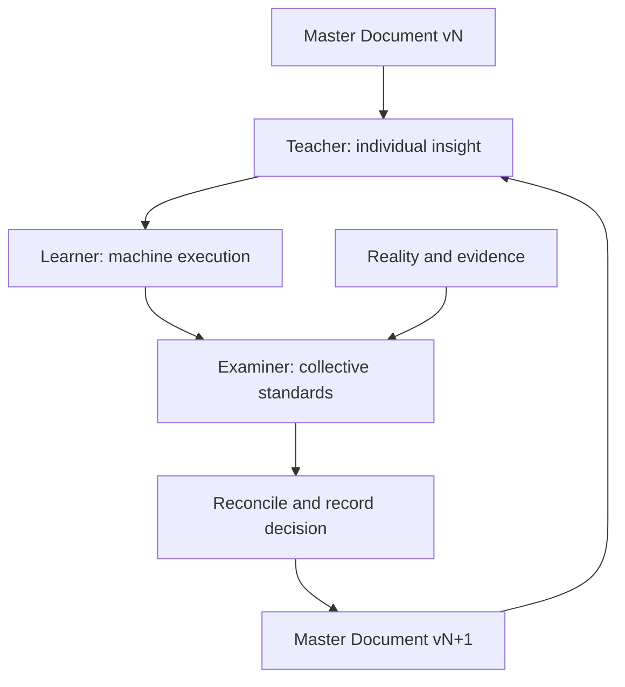

# TISE Repository Template

Triune Intelligent Smart Engine: a repository that tells the evolving story of a co-produced Master Document.

**Individual human intelligence designs possibilities. Machine intelligence implements and demonstrates them. Collective human intelligence examines them. Reality supplies evidence.**

Teacher represents individual insight; Learner is the system under development; Examiner represents documented collective standards. These are roles, not necessarily separate people or models. An AI acting as Examiner does not itself constitute a crowd or consensus.

## Start here

1. Create a repository using this template, or publish this package following [GitHub setup](docs/GITHUB_SETUP.md).
2. Edit [Master Document](master/MASTER.md): application, users, initial/final situations, design, knowledge, skills, standards, success criteria.
3. Register sources in `knowledge/SOURCES.csv`; put authorized local inputs in `cases/local/` (ignored by Git).
4. Run `python3 scripts/new_cycle.py cycle-001`.
5. Give Codex `prompts/teacher.md`, then `prompts/learner.md`, then `prompts/examiner.md`, with the cycle ID. Use separate sessions for independent examination.
6. Review the findings and update proposal. Record the human decision and revise Master Document, version, and changelog when closing the cycle.
7. Run `python3 scripts/validate.py`, commit the episode, and open a pull request using the supplied template.

## Repository map

| Path | Story it records |
|---|---|
| `master/` | Current synthesis, its version, and lessons |
| `AGENTS.md` | Codex governance and role boundaries |
| `prompts/` | Teacher, Learner, Examiner, reconciliation tasks |
| `procedures/` | Reusable competence procedures, explicitly read by prompts |
| `knowledge/` | Source provenance, human insight, shared standards |
| `src/` | Application implementation |
| `experiments/` | Protocols and empirical evidence |
| `cycles/` | Each episode and its result, evaluation, and update |
| `applications/` | Application-specific adaptations |
| `templates/` | Structured records copied into a cycle |
| `.github/` | GitHub validation, issue and pull-request templates |

## Important distinctions

Prompt-based teaching changes task context and procedures; it does not automatically retrain model weights. Collective claims need attributed sources and explicit authority. Git records tracked changes; retain discussion summaries and evidence links to preserve the wider story. Template-generated repositories begin their own history.

`procedures/` contains ordinary Markdown procedures, not automatically discovered Codex skills. This template does not install personal skills or assume a multi-agent runtime.

No application data or institutional rules are bundled. The dissertation-review example is an adaptation scaffold, not an ITB-approved rubric. No reuse license is selected: the owner should choose and add one before inviting external reuse.
